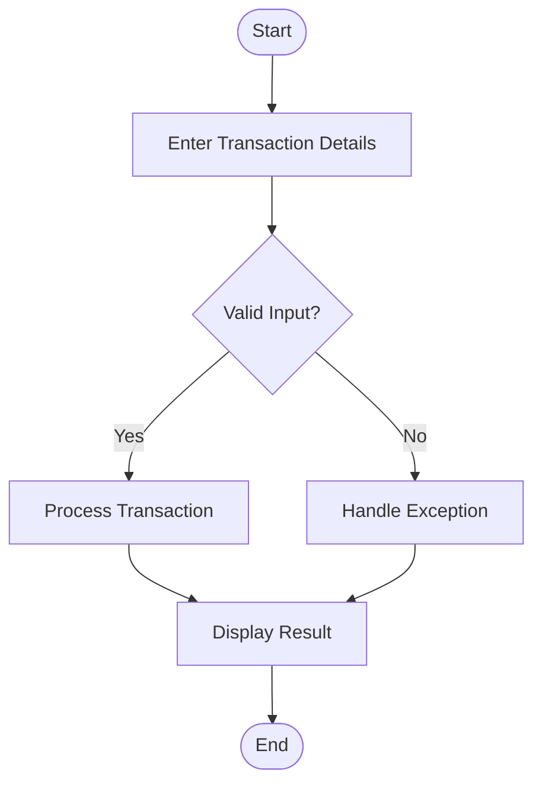
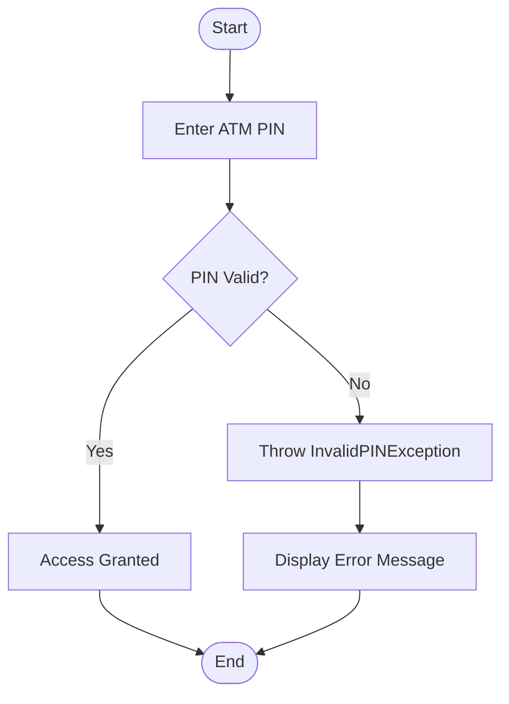
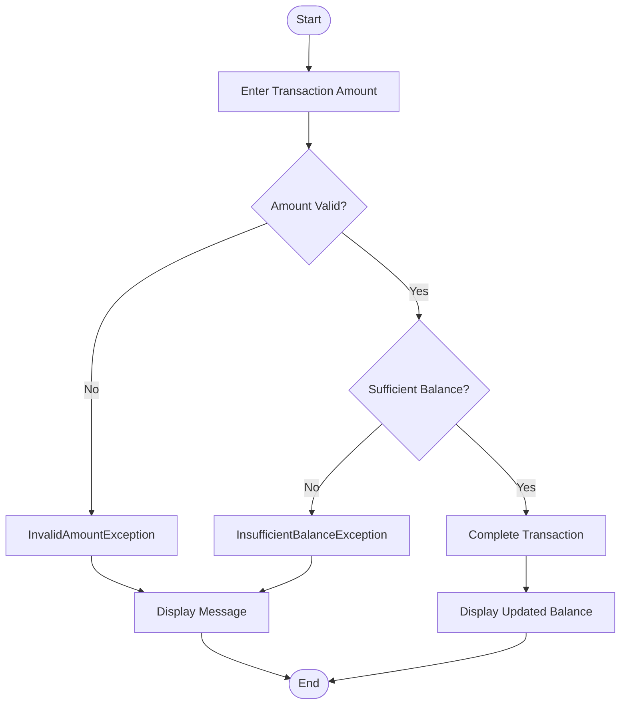
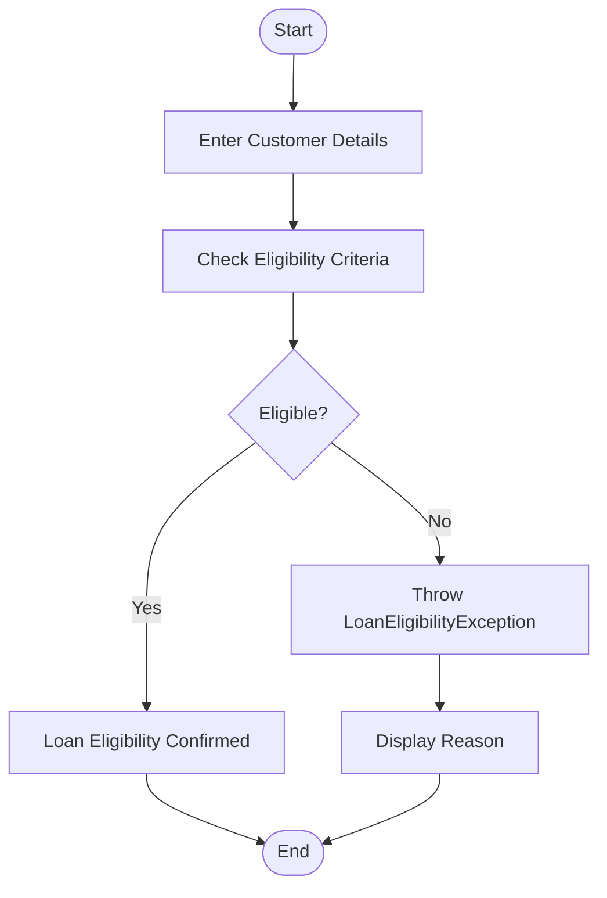

# ☕ Java Practical 12 — Exception Handling

<p align="center">
  
  
  
</p>

<p align="center">
  <b>Institute of Computer Technology</b><br>
  Ganpat University<br>
  B.Tech — Computer Science and Engineering
</p>

---

## 📌 About the Practical

This practical focuses on **Exception Handling in Java**. It demonstrates how to identify errors, create custom exceptions, validate user input, and handle exceptional situations using Java's exception-handling mechanisms.

The programs use real-world examples such as ATM transactions, PIN validation, banking operations, and loan eligibility checks.

## 🎯 Objectives

- Understand exception handling in Java.
- Use `try`, `catch`, and `throw`.
- Create and use custom exception classes.
- Validate user input and transaction amounts.
- Handle insufficient bank balances.
- Apply exception handling to real-world scenarios.

## 📚 Questions Covered

| Question | Program | Main Concept |
|---|---|---|
| Q1 | ATM System | Exception handling in ATM transactions |
| Q2 | ATM PIN Validation | Custom exception for an invalid PIN |
| Q3 | Banking System | Invalid amount and insufficient balance exceptions |
| Q4 | Loan Eligibility | Custom exception for loan eligibility validation |

---

## 🗂️ Project Structure

```text
Java_Practical_12/
│
├── README.md
│
├── Question_1/
│   ├── ATM.java
│   └── README.md
│
├── Question_2/
│   ├── InvalidPINException.java
│   ├── ATMUser.java
│   └── README.md
│
├── Question_3/
│   ├── InvalidAmountException.java
│   ├── InsufficientBalanceException.java
│   ├── BankAccount.java
│   └── README.md
│
└── Question_4/
    ├── LoanEligibilityException.java
    ├── Customer.java
    ├── Main.java
    └── README.md
```

*Note: Keep the filenames and folder structure consistent with your actual source code.*

---

## 🔹 Question 1: ATM System

**Objective:** Develop an ATM program that demonstrates exception handling during ATM operations.

### Working Flowchart



### Concepts Used

- `try` and `catch`
- Input validation
- Exception handling
- Transaction processing

---

## 🔹 Question 2: ATM PIN Validation

**Objective:** Validate an ATM PIN and handle invalid PIN entries using a custom exception.

### Working Flowchart



### Concepts Used

- Custom exception class
- `throw` keyword
- PIN validation
- Exception handling

---

## 🔹 Question 3: Banking System

**Objective:** Implement a banking system that handles invalid transaction amounts and insufficient account balances.

### Working Flowchart



### Concepts Used

- Custom exceptions
- Account balance validation
- Transaction processing
- Error handling

---

## 🔹 Question 4: Loan Eligibility

**Objective:** Develop a loan eligibility program that checks customer details and handles ineligible applications using a custom exception.

### Working Flowchart



### Concepts Used

- Custom exception handling
- Conditional statements
- Input validation
- Real-world business logic

*The exact eligibility conditions depend on the criteria implemented in the source code.*

---

## 🛠️ Technologies Used

- **Programming Language:** Java
- **Core Concepts:** Exception Handling, Classes and Objects
- **Exception Mechanisms:** `try`, `catch`, `throw`, custom exceptions
- **IDE:** IntelliJ IDEA / Visual Studio Code

## ▶️ How to Run

### Step 1: Clone the Repository

```bash
git clone https://github.com/rajsyntax/Java_Practical_12.git
```

### Step 2: Open the Project

Open the downloaded folder in IntelliJ IDEA or Visual Studio Code.

### Step 3: Compile the Program

Open the relevant question folder in the terminal and compile its Java files.

For example, for Question 2:

```bash
javac InvalidPINException.java ATMUser.java
```

### Step 4: Execute the Program

Run the class containing the `main()` method:

```bash
java ATMUser
```

**Important:** The execution command depends on the class containing `main()`. For programs containing multiple related Java files, compile all required files together.

---

## 🧠 Key Learning Outcomes

After completing this practical, students should be able to:

- Explain why exception handling is required.
- Differentiate normal execution from exceptional execution.
- Create custom exception classes.
- Validate ATM PINs and banking transactions.
- Handle invalid amounts and insufficient balances.
- Apply exception-handling concepts to practical applications.

## 📌 Conclusion

This practical demonstrates how Java exception handling improves program reliability and makes applications more robust. The ATM, banking, PIN validation, and loan eligibility examples provide practical experience in identifying, throwing, and handling exceptions.

---

<p align="center">
  <b>Java Practical 12 | Exception Handling</b><br>
  Made for learning, practicing, and improving Java programming skills.
</p>
