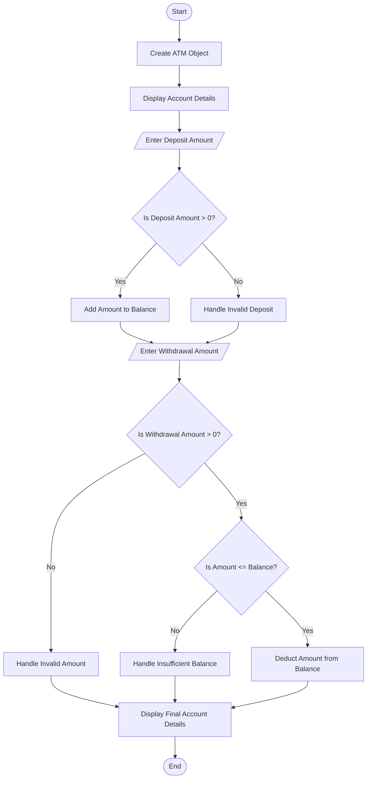

# 🏧 ATM Withdrawal System

A simple Java console-based ATM application that demonstrates **deposit, withdrawal, balance checking, and exception handling**.

## 📌 Project Overview

The ATM Withdrawal System allows a user to perform basic banking operations. It validates deposit and withdrawal amounts and handles invalid transactions using Java exception handling.

## 🎯 Objectives

- Understand classes and objects in Java.
- Perform deposit and withdrawal operations.
- Validate transaction amounts.
- Handle exceptions using `try`, `catch`, and `throw`.
- Display account details and the updated balance.

## ✨ Features

- Display account holder details.
- Deposit money into an account.
- Withdraw money from an account.
- Prevent invalid deposit amounts.
- Prevent withdrawals exceeding the available balance.
- Display the final account balance.

## 📂 Project Structure

```text
Question_1_ATM/
├── ATM.java
├── Main.java
└── README.md
```

## 🔄 Program Flowchart



## 🧠 Concepts Used

| Concept | Description |
|---|---|
| Class and Object | Represents an ATM account |
| Constructor | Initializes account details and balance |
| Encapsulation | Keeps account data private |
| Methods | Performs deposit, withdrawal, and balance display |
| `if-else` | Validates transaction conditions |
| `try-catch` | Handles exceptions |
| `throw` | Throws an exception for an invalid transaction |

## 📄 File Description

### 1. `ATM.java`

Contains the `ATM` class and its methods:

- `deposit(double amount)` — adds money to the account.
- `withdraw(double amount)` — withdraws money after validation.
- `displayBalance()` — displays the current balance.

### 2. `Main.java`

Contains the `main()` method. It creates the ATM object, accepts input from the user, performs transactions, and displays the final account details.

## ▶️ How to Run

1. Open the project in IntelliJ IDEA.
2. Ensure `ATM.java` and `Main.java` are in the same package or source folder.
3. Open `Main.java`.
4. Click the **Run** button.
5. Enter the deposit and withdrawal amounts when prompted.

## 💻 Sample Output

```text
===== ATM WITHDRAWAL SYSTEM =====
Account Holder: Rajesh
Account Number: 1234567890
Current Balance: ₹10000.0

Enter deposit amount: 2000
Deposit successful.

Enter withdrawal amount: 3000
Withdrawal successful.

===== FINAL ACCOUNT DETAILS =====
Account Holder: Rajesh
Account Number: 1234567890
Available Balance: ₹9000.0
```

*Note: The output may vary depending on the amounts entered by the user.*

## 🧪 Test Cases

| Test Case | Input | Expected Result |
|---|---|---|
| Valid deposit | `2000` | Deposit successful |
| Invalid deposit | `0` | Invalid amount handled |
| Valid withdrawal | `3000` | Withdrawal successful if balance is sufficient |
| Excess withdrawal | Amount greater than balance | Insufficient balance handled |
| Negative withdrawal | `-500` | Invalid amount handled |

## ⚠️ Exception Handling

The program validates transactions to prevent invalid operations.

- An invalid amount should raise an exception.
- A withdrawal greater than the available balance should be rejected.
- Exceptions are handled using `try-catch` blocks so the program can display an appropriate message.

## 🚀 Future Improvements

- Accept account details from the user.
- Add PIN authentication.
- Support multiple bank accounts.
- Store transaction history.
- Connect the application to a database.

## ✅ Conclusion

This practical demonstrates how Java classes, objects, methods, conditional statements, and exception handling can be used to implement a basic ATM Withdrawal System.
