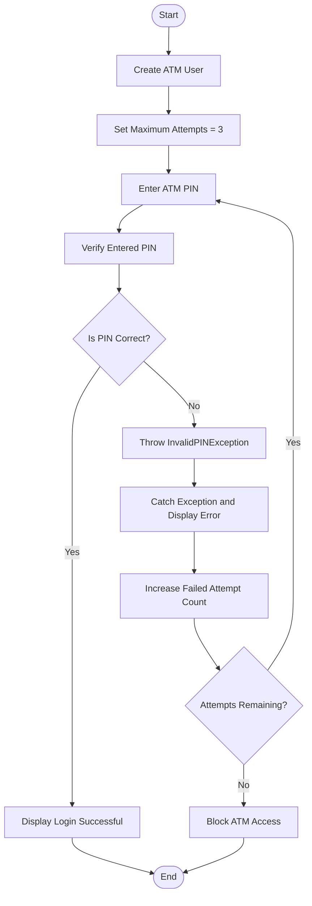

# 🔐 ATM PIN Validation System

A simple Java console-based application that validates a user's ATM PIN and restricts access after three incorrect attempts.

## 📌 Project Overview

The ATM PIN Validation System verifies whether the PIN entered by the user matches the stored ATM PIN. The user gets a maximum of **3 attempts** to enter the correct PIN. If all attempts fail, access is blocked.

This practical demonstrates custom exceptions and Java exception-handling mechanisms.

## 🎯 Objectives

- Understand custom exception handling in Java.
- Validate user-entered PINs.
- Limit the number of incorrect attempts.
- Use `try`, `catch`, `throw`, and `throws`.
- Understand how to create and use a custom exception class.

## ✨ Features

- Store account holder details.
- Validate the entered ATM PIN.
- Allow a maximum of three attempts.
- Display an error message for an incorrect PIN.
- Block access after three failed attempts.
- Display a success message when the correct PIN is entered.

## 📂 Project Structure

```text
Question_2_ATM_PIN_Validation/
├── InvalidPINException.java
├── ATMUser.java
├── Main.java
└── README.md
```

## 🔄 Program Flowchart



## 🧠 Concepts Used

| Concept | Description |
|---|---|
| Class and Object | Represents the ATM user |
| Encapsulation | Keeps account details and PIN private |
| Custom Exception | Defines `InvalidPINException` |
| `throw` | Throws an exception when the PIN is incorrect |
| `throws` | Declares an exception that a method may throw |
| `try-catch` | Handles an invalid PIN |
| Loop | Allows up to three PIN attempts |
| Conditional Statements | Checks PIN correctness and remaining attempts |

## 📄 File Description

### 1. `InvalidPINException.java`

Defines a custom exception class for an incorrect ATM PIN.

### 2. `ATMUser.java`

Contains the ATM user details and PIN verification logic.

Main responsibility:

- Store the account holder's name, account number, and PIN.
- Compare the entered PIN with the stored PIN.
- Throw `InvalidPINException` when the PIN is incorrect.

### 3. `Main.java`

Contains the `main()` method and controls the PIN validation process.

Main responsibility:

- Create an ATM user object.
- Ask the user to enter the PIN.
- Allow a maximum of three attempts.
- Handle incorrect PIN exceptions.
- Display the final result.

## ▶️ How to Run

1. Open the project in IntelliJ IDEA.
2. Ensure all three Java files are in the same package or source folder.
3. Open `Main.java`.
4. Click **Run**.
5. Enter the ATM PIN when prompted.

**Demo PIN:** `2580`

Use this PIN only for the sample program, not for a real bank account.

## 💻 Sample Output

### Case 1: Correct PIN

```text
===== ATM PIN VALIDATION =====

Enter ATM PIN: 2580

PIN verified successfully!
Access granted.
```

### Case 2: Incorrect PIN

```text
===== ATM PIN VALIDATION =====

Enter ATM PIN: 1234
Invalid PIN! Please try again.

Enter ATM PIN: 1111
Invalid PIN! Please try again.

Enter ATM PIN: 2222
Invalid PIN! Please try again.

Maximum attempts exceeded.
ATM access blocked.
```

*Note: The output may vary depending on the PINs entered.*

## 🧪 Test Cases

| Test Case | Input | Expected Result |
|---|---|---|
| Correct PIN on first attempt | `2580` | Access granted |
| Incorrect PIN once | `1234` | Error displayed; another attempt allowed |
| Correct PIN on second attempt | `1234`, then `2580` | Access granted |
| Three incorrect PINs | Three wrong PINs | Access blocked |
| Incorrect PIN every time | Three invalid entries | Maximum attempts exceeded |

## ⚠️ Exception Handling

The program uses a custom exception named `InvalidPINException`.

- `throw` is used when the entered PIN is incorrect.
- `throws` declares that the verification method may throw the custom exception.
- `try-catch` handles the exception and displays an appropriate message.
- A loop tracks the number of failed attempts and blocks access after three failures.

## 🚀 Future Improvements

- Hide PIN characters during input.
- Add account lockout and reset functionality.
- Store account details securely.
- Add transaction options after successful authentication.
- Connect the system to a database.

## ✅ Conclusion

This practical demonstrates ATM PIN verification using Java classes, encapsulation, loops, custom exceptions, and exception-handling mechanisms. It also shows how repeated incorrect PIN attempts can be restricted to improve basic access control.
