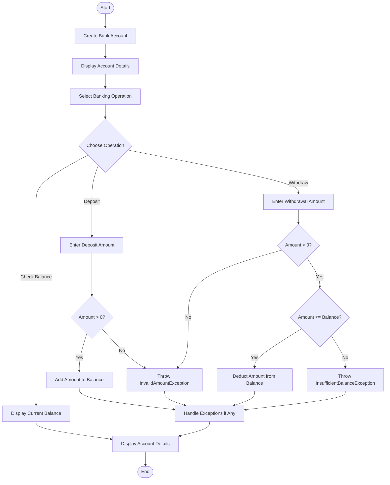

# 🏦 Banking System Using Exception Handling

A simple Java console-based banking application that performs basic banking operations and handles invalid transactions using custom exceptions.

## 📌 Project Overview

The Banking System allows users to deposit money, withdraw money, check their account balance, and display account details.

The program uses custom exceptions to handle invalid deposit amounts and withdrawals that exceed the available balance. It demonstrates Java exception handling using `try`, `catch`, `throw`, and `throws`.

## 🎯 Objectives

- Understand classes and objects in Java.
- Implement basic banking operations.
- Validate deposit and withdrawal amounts.
- Create and use custom exception classes.
- Handle invalid amounts and insufficient balance.
- Display account details and the updated balance.

## ✨ Features

- Store account number, account holder name, and balance.
- Deposit money into the account.
- Withdraw money from the account.
- Check the current account balance.
- Display account details.
- Handle invalid amounts using `InvalidAmountException`.
- Handle insufficient balance using `InsufficientBalanceException`.

## 📂 Project Structure

```text
Question_3_Banking_System/
├── InvalidAmountException.java
├── InsufficientBalanceException.java
├── BankAccount.java
├── Main.java
└── README.md
```

## 🔄 Program Flowchart



## 🧠 Concepts Used

| Concept | Description |
|---|---|
| Class and Object | Represents a bank account |
| Constructor | Initializes account details and balance |
| Encapsulation | Keeps account data private |
| Methods | Implements deposit, withdrawal, and balance checking |
| Custom Exceptions | Handles invalid amounts and insufficient balance |
| `throw` | Throws an exception when a transaction is invalid |
| `throws` | Declares exceptions that a method may throw |
| `try-catch` | Handles exceptions without abruptly terminating the program |
| Conditional Statements | Validates transaction rules |

## 📄 File Description

### 1. `InvalidAmountException.java`

Defines a custom exception for invalid transaction amounts, such as zero or negative values.

### 2. `InsufficientBalanceException.java`

Defines a custom exception for withdrawal amounts greater than the available account balance.

### 3. `BankAccount.java`

Contains the `BankAccount` class and its banking operations:

- `deposit(double amount)` — deposits money into the account.
- `withdraw(double amount)` — withdraws money after validating the amount and balance.
- `checkBalance()` — returns or displays the current balance.
- `displayAccountDetails()` — displays account information.

### 4. `Main.java`

Contains the `main()` method. It creates a bank account, performs sample deposit and withdrawal operations, handles exceptions, and displays the final balance.

## ▶️ How to Run

1. Open the project in IntelliJ IDEA.
2. Ensure all Java files are in the same package or source folder.
3. Open `Main.java`.
4. Click **Run**.
5. Observe the banking operations and exception messages in the console.

## 💻 Sample Output

```text
===== BANKING SYSTEM =====

Account Holder: Harsh
Account Number: 1001
Initial Balance: ₹20000.0

Depositing ₹5000.0...
Deposit successful.

Withdrawing ₹8000.0...
Withdrawal successful.

Withdrawing ₹30000.0...
Transaction failed: Insufficient balance.

===== FINAL ACCOUNT DETAILS =====
Account Holder: Harsh
Account Number: 1001
Available Balance: ₹17000.0
```

*Note: The output is based on the sample values used in the program.*

## 🧪 Test Cases

| Test Case | Input | Expected Result |
|---|---|---|
| Valid deposit | `5000` | Deposit successful |
| Zero deposit | `0` | Invalid amount exception |
| Negative deposit | `-1000` | Invalid amount exception |
| Valid withdrawal | `8000` | Withdrawal successful if balance is sufficient |
| Excess withdrawal | `30000` | Insufficient balance exception |
| Check balance | No amount required | Current balance displayed |

## ⚠️ Exception Handling

The program uses two custom exceptions:

- **`InvalidAmountException`** — raised when a deposit or withdrawal amount is zero or negative.
- **`InsufficientBalanceException`** — raised when the withdrawal amount exceeds the available balance.

The `try-catch` mechanism handles these exceptions and displays appropriate messages. The `throw` keyword raises an exception, while `throws` declares exceptions in method signatures where required.

## 🚀 Future Improvements

- Allow users to select operations through a menu.
- Support multiple bank accounts.
- Add PIN-based authentication.
- Store transaction history.
- Connect the application to a database.
- Add fund transfers between accounts.

## ✅ Conclusion

This practical demonstrates how Java classes, objects, encapsulation, methods, and custom exception handling can be used to develop a basic banking system. It helps prevent invalid transactions and demonstrates how exceptions can improve program reliability.
