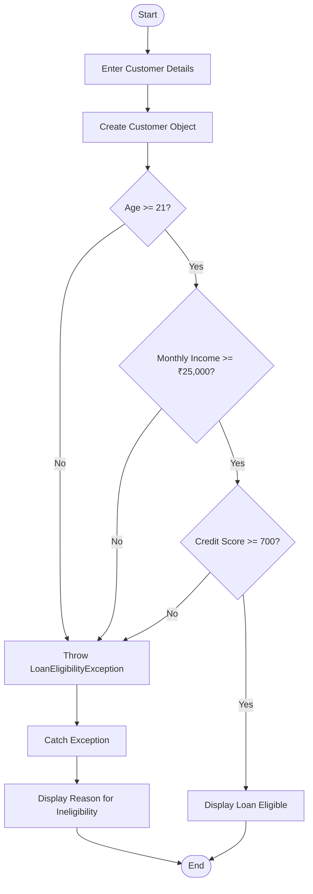

# 🏦 Bank Loan Eligibility System

A simple Java console-based application that checks whether a customer is eligible for a bank loan based on age, monthly income, and credit score.

## 📌 Project Overview

The Bank Loan Eligibility System evaluates a customer's loan eligibility using predefined conditions.

A customer must satisfy all three requirements:

- **Age:** At least 21 years.
- **Monthly Income:** At least ₹25,000.
- **Credit Score:** At least 700.

If any condition is not satisfied, the program throws a custom `LoanEligibilityException` and displays the reason for ineligibility.

## 🎯 Objectives

- Understand classes and objects in Java.
- Accept and validate customer information.
- Apply conditional statements to check loan eligibility.
- Create and use a custom exception.
- Handle exceptions using `try`, `catch`, `throw`, and `throws`.

## ✨ Features

- Store customer name, age, monthly income, and credit score.
- Check the minimum age requirement.
- Validate monthly income.
- Verify the minimum credit score.
- Display loan eligibility status.
- Show the reason when a customer is not eligible.
- Handle loan eligibility failures using a custom exception.

## 📂 Project Structure

```text id="l6h2kx"
Question_4_Loan_Eligibility/
├── LoanEligibilityException.java
├── Customer.java
├── Main.java
└── README.md
```

## 🔄 Program Flowchart



## 🧠 Concepts Used

| Concept | Description |
|---|---|
| Class and Object | Represents a customer |
| Constructor | Initializes customer information |
| Encapsulation | Organizes customer data and eligibility logic |
| Conditional Statements | Checks age, income, and credit score |
| Custom Exception | Defines `LoanEligibilityException` |
| `throw` | Throws an exception when a requirement fails |
| `throws` | Declares an exception in a method signature |
| `try-catch` | Handles eligibility exceptions |

## 📄 File Description

### 1. `LoanEligibilityException.java`

Defines a custom exception for customers who do not satisfy the loan eligibility conditions.

### 2. `Customer.java`

Contains the customer details and loan eligibility validation logic.

Main responsibilities:

- Store the customer's name, age, monthly income, and credit score.
- Check each eligibility requirement.
- Throw `LoanEligibilityException` if a requirement is not met.
- Report the customer's eligibility status when all conditions are satisfied.

### 3. `Main.java`

Contains the `main()` method.

Main responsibilities:

- Create a customer object.
- Provide sample customer information.
- Call the loan eligibility checking method.
- Handle exceptions and display the result.

## 📏 Loan Eligibility Rules

| Requirement | Minimum Condition |
|---|---|
| Age | 21 years |
| Monthly Income | ₹25,000 |
| Credit Score | 700 |

The customer must satisfy **all three conditions** to qualify under this program's rules.

## ▶️ How to Run

1. Open the project in IntelliJ IDEA.
2. Ensure all three Java files are in the same package or source folder.
3. Open `Main.java`.
4. Click **Run**.
5. View the eligibility result in the console.

## 💻 Sample Output

### Case 1: Customer Not Eligible

```text id="j7pq3w"
===== BANK LOAN ELIGIBILITY SYSTEM =====

Customer Name: Rahul
Age: 25
Monthly Income: ₹30000.0
Credit Score: 620

Loan Eligibility Check Failed!
Reason: Credit score must be at least 700.
```

### Case 2: Customer Eligible

```text id="k9c4fp"
===== BANK LOAN ELIGIBILITY SYSTEM =====

Customer Name: Amit
Age: 28
Monthly Income: ₹40000.0
Credit Score: 750

Congratulations! Customer is eligible for a loan.
```

*Note: These are illustrative outputs. Exact messages may vary depending on the implementation and input values.*

## 🧪 Test Cases

| Test Case | Age | Monthly Income | Credit Score | Expected Result |
|---|---:|---:|---:|---|
| All conditions satisfied | 25 | ₹30,000 | 750 | Eligible |
| Age below minimum | 20 | ₹30,000 | 750 | Not eligible |
| Income below minimum | 25 | ₹20,000 | 750 | Not eligible |
| Credit score below minimum | 25 | ₹30,000 | 620 | Not eligible |
| All conditions fail | 18 | ₹15,000 | 500 | Not eligible |

## ⚠️ Exception Handling

The program uses the custom exception `LoanEligibilityException`.

- The eligibility method checks the customer details.
- If a condition fails, the method throws the custom exception.
- The `try-catch` block catches the exception and displays the reason.
- If all conditions pass, the program displays a success message.

## 🚀 Future Improvements

- Accept customer details interactively.
- Calculate the eligible loan amount.
- Add loan tenure and interest-rate calculations.
- Store customer applications in a database.
- Generate a loan eligibility report.
- Add a graphical user interface.

## ✅ Conclusion

This practical demonstrates how Java conditional statements and custom exception handling can be used to build a basic loan eligibility checker. It shows how customer information can be validated against predefined eligibility requirements.
